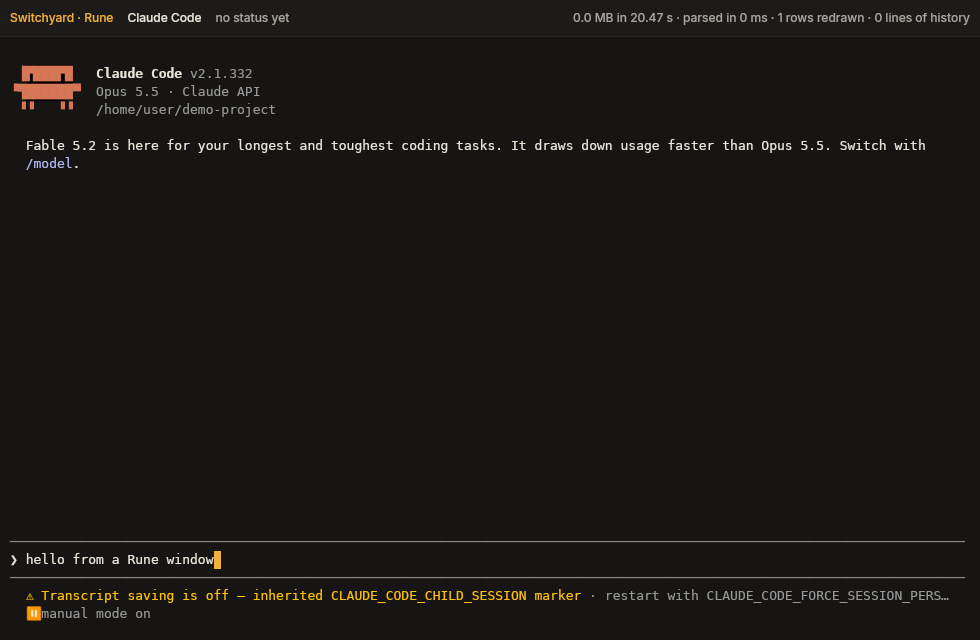
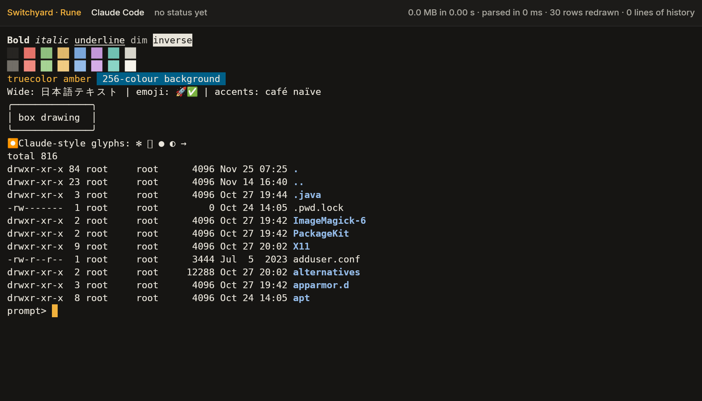

# Rune proof of concept

One Claude Code session in a native [Rune](https://github.com/anomalyco/rune) window, to decide
whether Switchyard's interface could move off the web view. It is not part of the app: a separate
crate with its own toolchain, built and tested by `.github/workflows/poc-rune.yml`.



## How it's built (about 1,100 lines plus tests)

| Part | What does it |
| --- | --- |
| Window, layout, text, input | Rune, pinned to `dev` rev `41607e9` (pre-release) |
| The screen | Rune's own terminal element, `grid` + `GridRow`: one shaped line per row, wide and fallback glyphs pinned to their columns, background and selection runs. Only rows that changed are rebuilt (`src/screen.rs`) |
| Terminal emulation | `alacritty_terminal` 0.26: escape codes, scrollback (10,000 lines), selection, modes |
| Pseudo-terminal | `portable-pty`, as Switchyard uses; a reader thread parses output in 8 KB chunks under the lock, a writer thread sends keys (`src/session.rs`) |
| Claude's status reports | a second, tiny `vte` pass over the same bytes for OSC 7501, which answers Claude Code's `7501;?` query so it sends reports |
| Keys | xterm encoding (`src/keys.rs`); Ctrl+Shift+C / Ctrl+Shift+V copy and paste (⌘C / ⌘V on macOS), so Ctrl+C and Ctrl+V stay Claude's |
| Accents and CJK input | Rune's `App::on_ime` and `El::ime_cursor` at the cursor (an app-drawn editor's input method) |

## Results

Measured on a 4-core Linux container with no GPU (software Vulkan), so window numbers are
pessimistic. Each row is a test in `src/tests.rs`, run against a real program in a real
pseudo-terminal through Rune's headless runtime, except the last two.

| Check | Result |
| --- | --- |
| Typing while output floods the screen | 24.7 MB of output; the typed line arrives intact; frames p50 2.5 ms, p95 4.9 ms, max 13 ms |
| 400,000 lines | all on screen 0.23 s after start; parsing 78 ms in all; history capped at 10,000 lines |
| Select and copy | a drag selects exactly `beta`; Ctrl+Shift+C copies it |
| Scrollback | the wheel scrolls back 100 lines; typing returns to the bottom |
| Resize | a smaller window gives the program a smaller terminal (`stty size` shows 19×74) |
| Bracketed paste | a two-line paste arrives wrapped in `ESC[200~ … ESC[201~` |
| Accents and composed input | `é`, `ñ` typed, `日本` committed by an input method: all reach the program |
| Claude's status protocol | the query is answered; a `blocked (permission)` report shows in the header |
| Real window, real keyboard (X11) | `café naïve 日本` typed through winit reaches the program |
| Real Claude Code | its start screen, trust prompt and prompt line render and take input |

Styles, colours and wide characters:



## What's not proven yet

- **Windows and macOS.** Nothing here ran on them. The workflow builds and tests on both, with
  Windows checks over ConPTY (output, typing with accents, a 200,000-line flood). It needs a
  pull request (or the workflow on `main`) to run.
- **Status reports from real Claude Code.** The protocol works against a scripted program; an idle
  Claude Code sent none in this container, and none was sent a prompt here.
- **Fonts.** `⎿` had no glyph in this container's fonts, and `⏺` / `⏸` fell back to colour emoji.
  On Windows and macOS the system fonts differ; Switchyard bundles coding fonts and would here too.
- **Memory and size.** 188 MB resident after 400,000 lines, but that includes the software Vulkan
  driver's compiler; a 34 MB stripped binary with Rune's default features. Both need measuring on
  real hardware.
- **Not built:** mouse reporting to programs, URL detection, search, the cursor's blink, a hollow
  cursor when unfocused, synchronized-output timeouts, more than one session.

## Run it

```bash
cd poc/rune-term
cargo run --release                         # claude in the current folder
SWITCHYARD_POC_CMD="htop" cargo run --release
cargo test --release -- --nocapture --test-threads=1   # the checklist, with its numbers
```

Linux needs `libxkbcommon-dev libwayland-dev` to build. The first build downloads the pinned Rust
toolchain (`rust-toolchain.toml`) and takes a few minutes.
